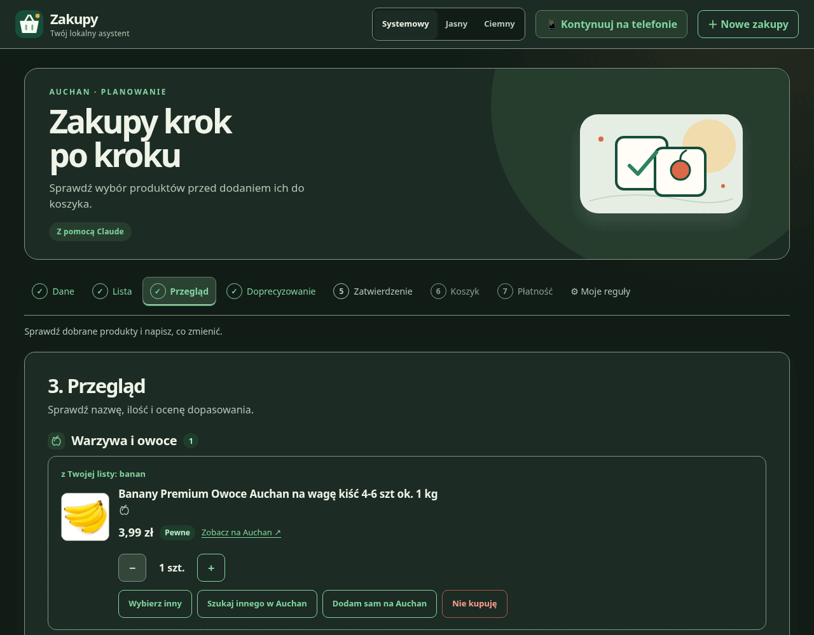
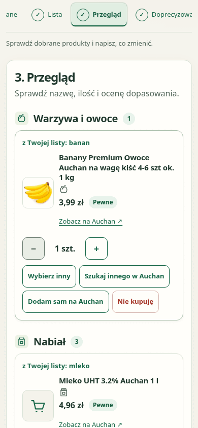

First, a disclaimer. Auchan doesn't sponsor this post. 😉

I usually buy groceries in person, mostly at Lidl. Some weeks there's no time to visit a
shop. My wife has night duties. We have four kids. Weekends get busy. In those weeks I order
online at zakupy.auchan.pl. Clicking through the online shop is tedious. I add the same "mąka" to the cart every time. Sometimes I hunt for the version of a
product that's on discount this week. The list in my head is short. The clicking is long.

I had also been reading and watching Anthropic's material on building harnesses. A harness is
the code around a model. It gives the model data, limits what it can do and checks its
output. I wanted to try building one on a real problem. Groceries were the obvious choice.

## What it does

The app is called **[auchan-shopping-harness](https://github.com/gregolsky/auchan-shopping-harness)**. It runs on my own computer. I paste my list the
way I'd write it on paper: `mleko 2`, `chleb`, `ser żółty, gouda albo edam`. The app matches
each line to a product. It uses my past orders to pick the one I usually buy. It also looks at
current promotions. It asks only about the lines it isn't sure of.

Then I approve the basket, and the app adds everything to my Auchan cart. The last step is
mine. I open Auchan, check the cart and pay. The app never pays and never places an order.
It can't open the payment pages, even by mistake.

When I pick a different product than the one it suggested, the app remembers. The next trip
starts with my choice. A few rules are there from day one. All Szymanowska flours are
blocked from the start.

I can start the list at my desk and finish it in the kitchen. The app shows a QR code. My
phone scans it and opens the same trip at the same step.

## From a skill to a harness

The first version, in June, was a Claude Code skill called `/zakupy`. Claude drove a Chrome
window and clicked through the shop. It worked, but Claude did all the work in the browser.

In November I rebuilt it as a harness. Most of the work moved into plain code:

- A local database holds my orders, prices, promotions and learned rules.
- A planner ranks products by how well they match the line, how often I bought them and
  their price.
- The cart is filled over Auchan's own HTTP endpoints in small batches. A second run never
  adds anything twice.

Claude now has a narrow job. It reads a free-form list and handles requests like "weź
większe mleko" ("take the bigger milk"). It runs with no tools and no access to my files.
It can answer only with a fixed set of operations. The server checks each one before
anything changes. Nothing happens until I click to accept. Claude is optional. Without it,
I write one product per line and the app asks about every doubtful match.

Guards sit around everything else. A hook blocks the checkout and payment pages. If Auchan
refuses a request, the app stops. It doesn't retry or try to get around Auchan's bot
protection. My login, address and order numbers never leave my computer.

## The catch

Matching a line of text to a product is harder than it looks. Ask for pierś z kurczaka and
you might get kiełbasa dla psa o smaku piersi z kurczaka, a dog sausage that tastes like
chicken breast. Claude read the search results and didn't see the difference between the
two products. Both names say chicken breast. Only one of them is for people.

The app has a few defenses. It rates how well each product matches the line and shows the
rating as a badge. It prefers products from my past orders. It asks when it isn't sure.
Still, a wrong match can slip through. I look at the cart before I pay, so the dog doesn't
get my dinner.

## Verification is the key

The app is about elegance and convenience. A trip is now a list, a few answers and one look
at the cart before paying. The most important part of the design is verification. It
happens at every step. The server checks every change Claude proposes. The app compares the
filled cart with the basket I approved. Finally, I check the cart on Auchan before I pay.
Each check catches mistakes the one before it missed.

And yes, I know the old automation joke. I spent several evenings automating a job to save
a few half-hours.

I haven't done the math. 🙂

The source is on [GitHub](https://github.com/gregolsky/auchan-shopping-harness). The README
explains how to set it up, if you shop at Auchan too.
